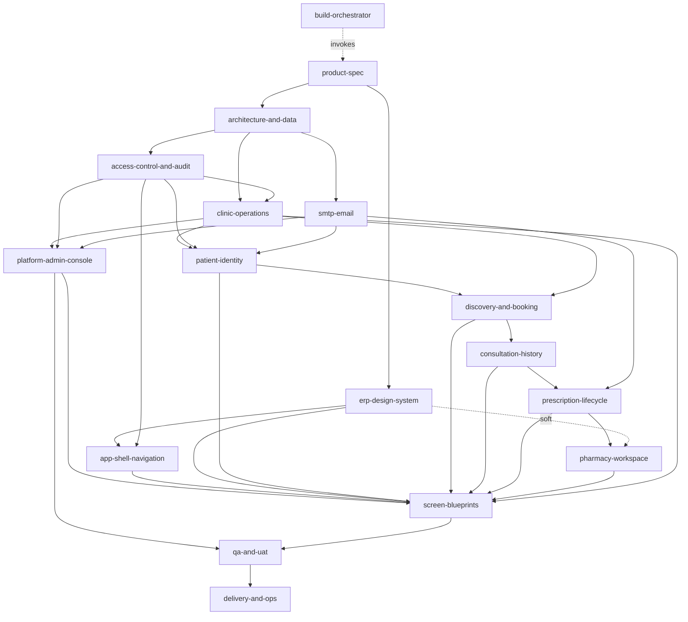

# 08 - Skill Dependency Graph (DAG, validated acyclic)

## Execution waves
| Wave | Skills | Parallel? |
|---|---|---|
| 0 | product-spec | - |
| 1 | architecture-and-data, erp-design-system | yes |
| 2 | access-control-and-audit, smtp-email-notifications | yes |
| 3 | erp-app-shell-navigation, clinic-operations-and-masters | yes |
| 4 | patient-identity-and-linking, platform-admin-console | yes |
| 5 | clinic-discovery-and-booking | - |
| 6 | consultation-and-medical-history | - |
| 7 | prescription-lifecycle | - |
| 8 | pharmacy-workspace | - |
| 9 | erp-screen-blueprints (applied incrementally as each domain lands) | - |
| 10 | clinicflow-qa-and-uat | - |
| 11 | clinicflow-delivery-and-ops | - |

Practical overlap: shell + design system are built in waves 1-3 and every later module is rendered inside them; pharmacy dashboard/users can start after wave 2; the Super Admin SMTP Settings screen should land early (wave 4) because email verification depends on it.
Hard vs soft: all listed edges are hard except pharmacy-workspace -> design-system (soft, watermark component) and product-spec -> design-system (soft).
Cycles found: none. (Potential tangle avoided: screen blueprints consume domain field lists, so domains never depend on UI skills.)
